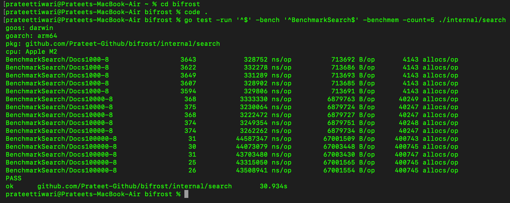

# Bifrost

A lightweight lexical search engine written in Go from scratch.

## Architecture

```text
Documents → Ingestion → Analysis → Inverted Index → bbolt

Query → Query Analysis → Retrieval → BM25 → Top-K Results
```

## Features

- Unicode-aware tokenization with positional offsets
- Lowercasing and accent folding
- Stop-word filtering and Porter stemming
- Positional inverted index
- Separate title and body indexing
- Phrase search
- BM25 ranking with title boosting
- Top-K (min-heap) result selection
- Compact posting encoding
- Persistent storage with bbolt
- Source fingerprinting and automatic index rebuilding

## Tech Stack

- **Language:** Go
- **Storage:** bbolt
- **Ranking:** BM25

## Getting Started

Run Bifrost:

```bash
go run ./cmd/bifrost
```

Enter a search query. Wrap a phrase in double quotes to perform phrase search.

```text
Query: distributed systems
Query: "distributed systems"
Query: :quit
```

## Testing

```bash
go test ./...
go test -race ./...
```

## Benchmarks

Benchmarked on Apple M2 (`darwin/arm64`).



| Corpus | Search Latency | Index Save Time |
| ---: | ---: | ---: |
| 1,000 documents | 329 µs | 14.41 ms |
| 10,000 documents | 3.24 ms | 52.57 ms |
| 100,000 documents | 43.9 ms | 512.89 ms |

These are local benchmark results, not production performance guarantees.
